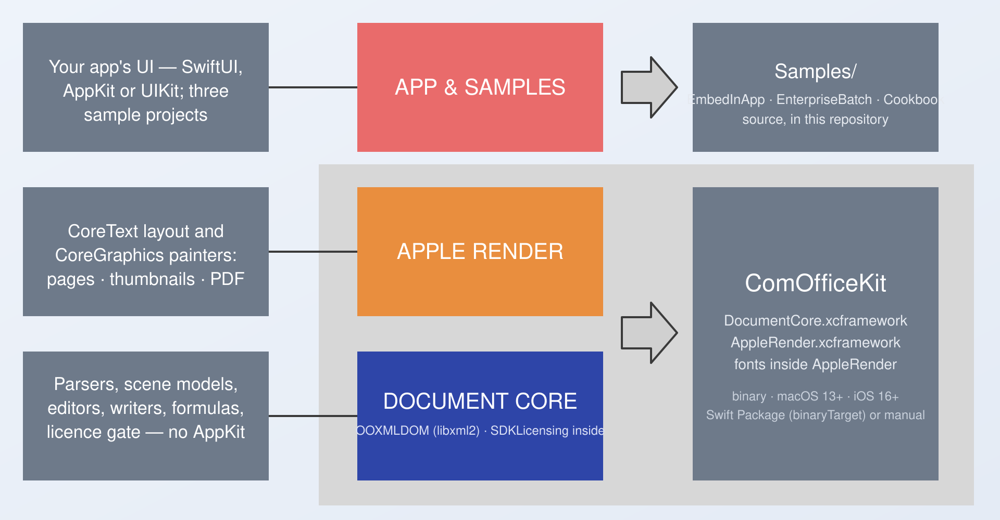

# ComOfficeKit

**Native DOCX · XLSX · PPTX for Apple platforms.** Parse, inspect, edit, save
and render Office documents from Swift — in-process, offline, on macOS and iOS.
Two binary frameworks, no LibreOffice, no server, no document ever leaves the
device. The engine is production software, not a demo: it ships in a commercial
application. ComOfficeKit packages it for licensing.

> **Current release: 1.3.0** — what changed: [CHANGELOG](CHANGELOG.md).
> Try it free with the evaluation key below, no sign-up: [Free trial and licence](#free-trial-and-licence).

```swift
import DocumentCore
import AppleRender

try SDKLicense.activate(key: licence)                              // signed line from your contract; verified on device

let scene = try DocumentParser.parse(docxAt: url)                  // structured DOCX
let doc   = ParsedDocument.word(scene)
let pages = try DocumentRenderer.pageCount(of: doc)
let png   = try DocumentRenderer.image(of: doc, page: 0, scale: 2)  // CGImage, Retina
let pdf   = try DocumentRenderer.pdfData(of: doc)                   // vector PDF, every page
```

## Architecture



Two binary frameworks and the source you build on top of them:

| Layer | What it is | Ships as |
|---|---|---|
| **App & samples** | your SwiftUI / AppKit / UIKit code; the three samples show the viewer, pipeline and cookbook shapes | source, in `Samples/` |
| **AppleRender** | CoreText layout and CoreGraphics painters behind one entry point, `DocumentRenderer` — page images, thumbnails, vector PDF | `AppleRender.xcframework` |
| **DocumentCore** | parsers, scene models, editors, writers, the formula engine, the licence gate; `OOXMLDOM` (a libxml2 wrapper) and `SDKLicensing` are internal to it | `DocumentCore.xcframework` |

The metric-compatible fonts ship inside `AppleRender.framework`. `DocumentCore` depends on Foundation and CoreGraphics only; `AppleRender` adds CoreText and ImageIO. Neither touches AppKit, UIKit, PDFKit or SwiftUI, which is why both ship in the iOS slice. Details: [API overview](docs/api-overview.md).

## What it does

| | DOCX | XLSX (+ `.xlsm`) | PPTX |
|---|---|---|---|
| **Read** into a typed scene | paragraphs, runs and formatting, tables (nested), sections, headers/footers, footnotes, inline and floating images, text boxes, shapes, lists, styles, tracked changes, comments and replies, hyperlinks, fields | sheets, typed cells (number / string / boolean / date / error), formulas with cached values, number formats, fonts / fills / borders / alignment, merges, column widths and row heights, frozen panes, tables, charts, pictures and shapes, pivot regions, conditional formatting, print setup and breaks, defined print areas, VBA presence | slides, text bodies with runs, pictures (with crop), tables, charts, groups, connectors, preset and custom geometry, fills / gradients / shadows, notes, hidden slides, backgrounds |
| **Render** through CoreGraphics | paginated pages: sections, margins, floats, widow/orphan control, East-Asian document grid, headers/footers, footnotes, tables, images, text boxes, shapes | print pagination per sheet: fit-to-page, scale, print areas, manual breaks, gridlines, charts | one page per slide: geometry, text layout, pictures, tables, charts, connectors, backgrounds |
| **Edit** the scene | insert / delete / replace text, character and paragraph formatting, lists, indents, tab stops, spacing, tables (rows, columns, copy), inline images, hyperlinks, text boxes, section breaks, find & replace, add / resolve / reply comments, accept / reject tracked changes | set values keeping styles, fonts, fills, number formats, column widths, insert / delete rows and columns, merges, frozen rows, rename sheets (formulas follow), tables, charts and pictures, conditional rules | replace text keeping formatting, move / resize shapes, notes, insert and replace pictures, add / duplicate / delete / reorder slides |
| **Write** back | byte-preserving: untouched paragraphs, tables and parts are copied from the original; only what changed is regenerated | byte-preserving per part; VBA in `.xlsm` copied verbatim (never executed); new pictures, tables and charts synthesised | byte-preserving per slide; new slides and pictures synthesised, deleted slides removed from the package |
| **Compute** | — | formula engine, ≈105 functions, dependency-ordered recalculation; `#DIV/0!`-style errors are values | — |

Two modules, both binary:

- **`DocumentCore`** — parse, scene models, editors, writers, formulas, the licence gate. Foundation + CoreGraphics only, so it runs anywhere Swift does on Apple platforms.
- **`AppleRender`** — CoreText layout and CoreGraphics painters behind one entry point, `DocumentRenderer`. Never imports AppKit, UIKit, PDFKit or SwiftUI, so it ships in the iOS slice.

Plus a JSON snapshot of any DOCX (`WordDocumentSceneJSON`) for agents, search indexes and diffs — see [Structure as JSON](docs/structure-json.md).

## Why in-process

| Approach | Documents leave the device | Needs a server or install | Works offline | Renders in your UI | Edits round-trip the original file |
|---|---|---|---|---|---|
| **ComOfficeKit** | no | no | yes | yes (CGImage / PDF) | yes, byte-preserving |
| Cloud conversion API | yes | yes | no | no | usually re-generates the file |
| LibreOffice headless | no | yes (hundreds of MB, a process to manage) | yes | no (files only) | re-generates the file |
| Web viewer / Office Online | yes | yes | no | in a web view | n/a |
| Hand-written OOXML XML | no | no | yes | no | only what you wrote |

## Requirements and footprint

| | |
|---|---|
| Platforms | macOS 13 or later · iOS 16 or later (device and simulator) |
| Toolchain | **Xcode 26 or later** to BUILD against (Swift 6.2, macOS 26 SDK). Xcode 16 cannot link these binaries — see [Getting started](docs/getting-started.md#toolchain). This is a build requirement only; the platforms above are what your app can RUN on. |
| Slices | `macos-arm64_x86_64`, `ios-arm64`, `ios-arm64_x86_64-simulator` |
| Archives | `DocumentCore.xcframework.zip` 24.7 MB · `AppleRender.xcframework.zip` 9.7 MB, fonts included (dynamic frameworks; each slice carries its dSYM, which stays out of your app) |
| Dependencies | none beyond Apple frameworks (`libxml2` from the SDK, CoreText, CoreGraphics, ImageIO, Security for the Keychain) |
| Network | **none, ever.** Licences are signed and verified on the device |
| Sandbox | fine: all ZIP and XML work is in-process, and the licence is verified on the device, so no network-client entitlement is needed |

## Install

Swift Package Manager:

```swift
dependencies: [
    .package(url: "https://github.com/ComOfficeKit/ComOfficeKit-Apple.git", from: "1.3.0"),
],
targets: [
    .target(name: "YourApp", dependencies: [
        .product(name: "DocumentCore", package: "ComOfficeKit-Apple"),
        .product(name: "AppleRender", package: "ComOfficeKit-Apple"),
    ]),
]
```

`package:` is `ComOfficeKit-Apple` because SwiftPM names a package after the last part of its
URL.

Both products are `binaryTarget`s downloaded from this repository's Releases
and verified by checksum. They are dynamic frameworks: an app embeds them
(*Embed & Sign*), and the fonts for Word/slide layout that matches Windows
metrics (Carlito ≙ Calibri, Caladea ≙ Cambria) come inside `AppleRender`.
Details, the manual Xcode route, command-line tools and a project checklist:
[Getting started](docs/getting-started.md).

Prefer a folder you can vendor? Each release also attaches
`ComOfficeKit-1.3.0.zip`: the frameworks, the fonts, the documentation and
the samples, with a `Package.swift` that refers to the frameworks by path. As a
path dependency it is named after its folder, `ComOfficeKit`, which is the
`package:` name the guides in `docs/` use.

## Free trial and licence

ComOfficeKit is commercial software, quoted and licensed by our sales team.
Every release also publishes a free evaluation key, so you can try the whole
SDK without signing up.

1. **How long.** The key below unlocks everything — DOCX, XLSX and PPTX,
   rendering and the formula engine — until **2027-01-01** at 00:00 UTC,
   about 60 days after this release. It names no app, so it also works in
   command-line tools and test runners. A later release publishes a new key.

   ```text
   A/wTnfL8iVOyAMG379JKLVofO3a2QRm8Xk3dhHhyoqBrahUjsNwkMwW/0HuPCBBjU5bRr4qH54EwuO4ktWbkntoNOtAicNTtRbGbaR1umP9vNsYbV9F0ijXSK1q8KO6lFTogPph0RNdnogPKToBkrW5z1AOZ/UeJUb34iT/MxaudYFxNme5g80SbUu3m+1oO4OdvN9ifBjwN9kZS+4gfuEjoK/9XDnSxtHSCHyhTGx7V1m4qaruZ5YIw6K/qYWL34d5ziYBWVewGNoQfYlyLIGrS7gmxSiS9QMDBjbnq+bgXF937MEHWyA0ujHKDxtwLosPI8oLZ1NSW4VAFQIvYsPQU1RxzE+64PWmYdGnEDP9KbTjuURizVFohnOIYhXAo6AgGg8quOZ3xmFihFFn9jYq2SpFUJgAZC0k05IbNShB3mU/cKhp70f3mzawrOoVM3PUiUqulIgajhWa/Gt7mZXw5uGATAOFzunTEAM3g4ZUTLDtpTKuOoWfIWjQaSasgEbQQ9Xg4/3r+aORj1MId+2rmCSz7560nlqFWkACCsdt8paXaWto3VBS2WzrahOEwMBh++TdsSn51QfmpH3qRtAxXgVcJGHgB7S9A8Liucx5cV26PKdl2TTJsKvUdamWrC2l+b6sDxoJ4wc1wj9IhAvPy7bPFBc4Zd2HZKMN5/2wwXwT3aqD04EuuM67JBGr2dFTJAPcQ6eOSTGNzLk1YuB7Ulk6dxH3TmzKtt9wGsKeK3Q/oXO7ABmiNbFWHgTKvsqyDXxHeK7Ri4thUgS3Wxe5s8HX1i6TTW2KMkfcOQhtbO/c31yBBlr9CMJT39fKQzILEGwia819ICvTnnVSesfl4ZmeE8pVwheQHULazVzEfjseekmrp4PJSElsVx7iC88ykv0uQax7th1OHOyLiII0CyuZ07Lkw+R0S2bT34gTiaCstveMZLVejcoHzKN4XQe78CAoB9A1cYf6w6lQtGeERjNxsVewLRS4Y5j3DtT9XgNXQE60Jo0zK6p5pLpAWW87aOJwRGeVLTzPa//4gKQ==
   ```

2. **How to apply it.** Pass it to `SDKLicense.activate(key:)` before the first
   call into the SDK; [Licensing](docs/licensing.md) covers storage, the
   licence states and the errors. Once the key has expired the SDK stops
   working until a licence key is applied.
3. **What it is for.** Evaluation only: build prototypes, run your tests and
   the samples. Do not ship, sell or distribute anything built on an
   evaluation key, or submit it to an app store. The
   [Service Terms](https://comofficekit.com/service-terms/) and [LICENSE.md](LICENSE.md) apply.
4. **Buying a licence.** For a production licence or a quote, email our sales
   team at **sales@comofficekit.com**.

## Documentation

| Start here | |
|---|---|
| [Getting started](docs/getting-started.md) | install, fonts, licence key, first parse and render, checklist |
| [API overview](docs/api-overview.md) | the two modules, which type does what, conventions |
| [Licensing](docs/licensing.md) | activation, states and errors, expiry, Keychain vs memory storage |

| Guides | |
|---|---|
| [DOCX](docs/guide-docx.md) | walk, extract, edit, format, tables, images, comments, tracked changes, save |
| [XLSX](docs/guide-xlsx.md) | cells and number formats, editing without losing styles, formulas, tables, pictures, CSV |
| [PPTX](docs/guide-pptx.md) | shapes and text, editing in place, pictures, slide add / duplicate / delete / reorder |
| [Rendering](docs/guide-rendering.md) | page images, thumbnails, vector PDF, fonts, threading |
| [Batch and server-side use](docs/guide-batch.md) | folder conversion, text extraction for indexes, legacy-format detection, exit codes |
| [Structure as JSON](docs/structure-json.md) | the DOCX snapshot schema for agents and pipelines |

| Reference | |
|---|---|
| API reference | `DocumentCore.doccarchive` and `AppleRender.doccarchive` attached to each release (every public declaration documented). Open in Xcode: *Window ▸ Developer Documentation ▸ import*. |
| [Errors and threading](docs/errors-and-threading.md) | the typed errors, what is `Sendable`, what to keep off the main thread |
| [Performance](docs/performance.md) | streaming parse, skipping picture decoding, render scales, caching scenes |
| [Limits and FAQ](docs/limits-and-faq.md) | what is not supported, and why |
| [App Store and distribution](docs/app-store-and-distribution.md) | embedding, entitlements, privacy manifest status |
| [Migration notes](docs/migration/README.md) | semver policy, changes between releases |

The guides' worked examples are functions in
[`Samples/Sample-Cookbook`](Samples/Sample-Cookbook), compiled against the
release frameworks, so a recipe that stops building fails that build instead of
misleading you. Blocks that enumerate signatures rather than show a recipe —
the editor call lists in the DOCX guide, for instance — are not compiled, and
nothing currently checks which is which.

## Samples

- [`Sample-EmbedInApp`](Samples/Sample-EmbedInApp) — a SwiftUI viewer where every opened document is a tab; pages render through `DocumentRenderer` off the main thread; a licence sheet handles the typed `notActivated` error. The "viewer app gaining Office support" shape.
- [`Sample-EnterpriseBatch`](Samples/Sample-EnterpriseBatch) — `batch render <file>` (→ PDF), `batch extract <file>` (DOCX text · XLSX TSV · PPTX notes), `batch convert <dir> --pdf <out>`; exit 1 on any failure, 3 on a licence error; key from `COMOFFICEKIT_KEY`. The pipeline shape.
- [`Sample-Cookbook`](Samples/Sample-Cookbook) — every guide sample as a compiled function, plus `cookbook <file>` which runs the read-only ones against a document.

All three consume the SDK exactly as a licensee does: binary only, no source. They are the acceptance test for every release. After cloning, run `Scripts/fetch-xcframeworks.sh` once: it downloads this release's frameworks into `XCFrameworks/`, where the samples expect them, and checks them against `Package.swift`.

## How we know it works

- **Corpus-gated.** The engine's nightly CI renders a corpus of real-world documents across the three formats and compares the result with LibreOffice renders; a regression in the similarity score blocks the release. The formula engine is measured cell by cell against Excel's own cached values.
- **API-frozen.** Two gates in the engine's CI — an inventory of every public symbol and a signature-level digest from `swift-api-digester` — fail on any change to the public surface, so nothing changes shape without a release note.
- **Round-trip-tested.** Writers are tested for verbatim copying of untouched parts and for preservation of styles, shared formulas, VBA and drawing parts across edits; an unmodified DOCX saves byte-identically.
- **Documented.** Every public declaration in both modules carries a doc comment; the reference archives ship with each release.

## Versioning, licensing, support

- **Versions** follow semantic versioning from 1.0; 0.9.x is the pre-release series (see [Migration notes](docs/migration/README.md)). Each release names the engine tag it was built from.
- **Licence.** ComOfficeKit is commercial software, licensed, not sold, by the company named in the [Service Terms](https://comofficekit.com/service-terms/); it is not open source — see [LICENSE.md](LICENSE.md). Evaluate with the key in [Free trial and licence](#free-trial-and-licence); for a production licence, email sales@comofficekit.com.
- **Support:** support@comofficekit.com
